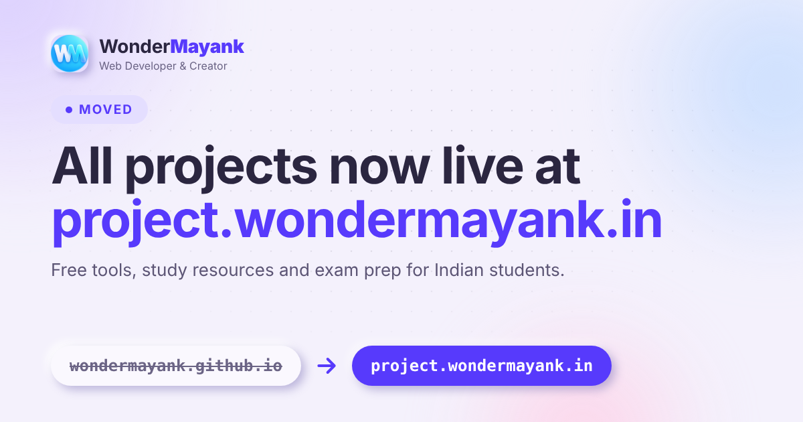

# Wondermayank

**All projects have moved to [project.wondermayank.in](https://project.wondermayank.in/)**

Free tools, exam-prep simulators and study resources by a student developer from India.

---

## 📍 What is this repo?

This repo (`wondermayank.github.io`) used to host every Wondermayank project. They now live at
**[project.wondermayank.in](https://project.wondermayank.in/)**, so this site only keeps:

- a short **creator page** (`index.html`) that links to the projects;
- a smart **`404.html`** — old links such as `/image` or `/Periodic-Table/v2` show a "This page has moved"
  screen and forward to the matching page on project.wondermayank.in (5-second countdown, with a *Stay here* button);
- the SEO and verification files search engines expect.

### 📁 Files

| File | Purpose |
|------|---------|
| `index.html` | Creator page — JSON-LD (Person, WebSite, FAQPage), FAQ and a crawler-friendly link list |
| `404.html` | Old-address router: maps old paths to project.wondermayank.in using the project sitemap |
| `sitemap.xml` | Only the creator page (projects have their own sitemap) |
| `robots.txt` | Crawler rules |
| `llms.txt` | AI-readable summary that points to project.wondermayank.in |
| `og-cover.png` | 1200×630 social preview — "All projects now live at project.wondermayank.in" |
| `favicon.svg`, `favicon.ico`, `apple-touch-icon.png`, `head.svg` | Icons and logo |
| `humans.txt`, `.well-known/security.txt` | Site and security info |
| `google1a15a2b883bed825.html`, `openai-domain-verification=…txt` | Ownership verification — keep these |

---

## 🧭 Where things live now

### 🔎 Finder
| Tool | Description | Link |
|------|-------------|------|
| Movie Finder | Search Indian and international movies, ratings & details | [→](https://project.wondermayank.in/finder/movie) |
| Anime Finder | Discover anime via Jikan API with full metadata | [→](https://project.wondermayank.in/finder/anime) |
| Book Finder | Find books by title, author or genre | [→](https://project.wondermayank.in/finder/books) |
| Games | Free browser games for PC & mobile | [→](https://project.wondermayank.in/finder/games) |
| Wallpaper | Wallpaper and mascot art gallery | [→](https://wallpaper.wondermayank.in) |

### 📚 Study
| Tool | Description | Link |
|------|-------------|------|
| CBT Mock Test | Exam simulator — CUET, NEET, JEE, Banking, SSC | [→](https://project.wondermayank.in/cbtmock) |
| Book Hub | Educational books and structured study resources | [→](https://project.wondermayank.in/study/book) |
| English Practice | Grammar, vocabulary and language tests | [→](https://project.wondermayank.in/cbtmock/english) |
| General Aptitude | Reasoning and awareness practice | [→](https://project.wondermayank.in/cbtmock/gat) |
| Current Affairs | Monthly, quarterly & yearly current affairs | [→](https://project.wondermayank.in/study/Current_Affairs) |
| Periodic Table | Interactive chemistry periodic table | [→](https://project.wondermayank.in/study/Periodic_Table/v2) |
| Hindi Typing | Learn and practise Hindi typing | [→](https://project.wondermayank.in/typing/hindi) |
| English Typing | English typing speed test | [→](https://project.wondermayank.in/typing/english) |

### ⚙️ Tools
| Tool | Description | Link |
|------|-------------|------|
| Paletteify | Free color palette generator for designers | [→](https://project.wondermayank.in/code/paletteify) |
| Text to PDF | Convert plain text to formatted PDF | [→](https://project.wondermayank.in/tools/pdftotext) |
| YouTube Transcript | Get the transcript of a YouTube video | [→](https://project.wondermayank.in/tools/transcript) |
| Help Tools | Daily helpers and quick-reference utilities | [→](https://project.wondermayank.in/help) |
| Card Generator | Digital cards for weddings, birthdays & events | [→](https://project.wondermayank.in/love/card) |
| Portfolio | Portfolio of Wondermayank | [→](https://portfolio.wondermayank.in) |

### 🇮🇳 India & Culture
| Page | Description | Link |
|------|-------------|------|
| What is India? | History, philosophy, geography & identity | [→](https://project.wondermayank.in/india) |
| Festivals of India | Diwali, Holi, Eid, Pongal & more | [→](https://project.wondermayank.in/india/festivals) |
| Indian Cuisine | Spices, flavours & regional cuisines | [→](https://project.wondermayank.in/india/cuisine) |
| Languages of India | Sanskrit, Tamil, Hindi, Bengali & 1600+ more | [→](https://project.wondermayank.in/india/languages) |
| Indian Art & Dance | Bharatanatyam, Madhubani & living heritage | [→](https://project.wondermayank.in/india/art) |
| History of India | Indus Valley to Independence | [→](https://project.wondermayank.in/india/history) |
| Kayastha | Community history and cultural traditions | [→](https://project.wondermayank.in/india/kayastha) |
| Rajput | Royal heritage and valor of Rajput clans | [→](https://project.wondermayank.in/india/rajput) |

---

## 🎓 Exam Prep (CBT Simulators)

Free Computer-Based Test simulators at [commercesehoga.github.io](https://commercesehoga.github.io/) (unchanged):

| Exam | Direct Link |
|------|-------------|
| CUET | [commercesehoga.github.io/dashboard](https://commercesehoga.github.io/dashboard) |
| NEET / JEE | [commercesehoga.github.io/jee-neet](https://commercesehoga.github.io/jee-neet) |
| Banking (SBI, IBPS) | [commercesehoga.github.io/banking](https://commercesehoga.github.io/banking) |
| SSC (CGL, CHSL) | [commercesehoga.github.io/ssc](https://commercesehoga.github.io/ssc) |

---

## 📡 Telegram Communities

| Channel / Group | Link |
|----------------|------|
| Wondermayank Community | [t.me/wondermayank](https://t.me/wondermayank) |
| Contact Bot | [t.me/Mindmaster_robot](https://t.me/Mindmaster_robot) |

---

## 🚀 Tech Stack

- Pure **HTML5 + CSS3 + Vanilla JavaScript** — zero build tools, zero dependencies
- Hosted on **GitHub Pages**
- Dark / Light theme toggle stored in `localStorage`

---

## 📄 Legal

- [Privacy Policy](https://wondermayank.in/privacy)
- [Terms & Conditions](https://wondermayank.in/terms)
- [Disclaimer](https://wondermayank.in/disclaimer)

---

© 2018 **Wondermayank**. All rights reserved.

Made with ❤️ in India · [project.wondermayank.in](https://project.wondermayank.in/)

